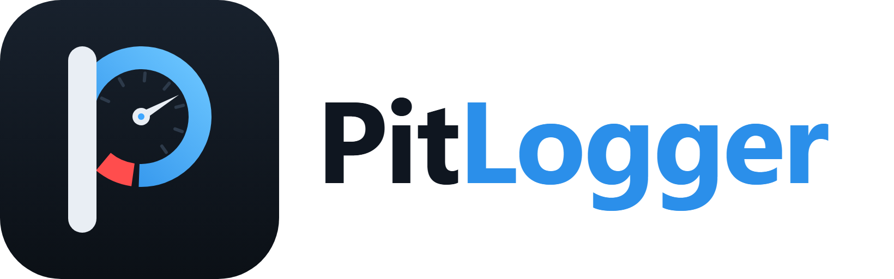

  <picture>
    <source media="(prefers-color-scheme: dark)" srcset="../branding/pitlogger-wordmark-dark.png">
    
  </picture>

<b>Open telemetry and data logging for your car.</b>

PitLogger turns an ESP32-S3 and a cheap ELM327 OBD-II adapter into a small telemetry system:
live vehicle data in your browser, trouble codes, and recordings of every drive – no app store,
no cloud, no subscription.

**What it does**

- 🔌 Connects to ELM327 adapters via Bluetooth Low Energy
- 📊 Live dashboard over its own Wi-Fi – speed, RPM, temperatures, fuel trims and more, with
  session min / avg / max
- 🚗 Reads vehicle info (VIN) and trouble codes (stored, pending, permanent)
- 💾 Records drives as `.pitlog` files on a microSD card
- 🧩 Planned: GPS, add-on modules via ESP-NOW (custom displays, gear indicator, function buttons),
  over-the-air updates

**Open by design**

The `.pitlog` file format will be openly documented, and the converter (to CSV, GPX and more)
will be free – as a web app and as a standalone tool – so your data stays readable even if
this project ever stops.

> 🚧 PitLogger is in early development.

## Repositories

| | |
|---|---|
| [elm327-emulator](https://github.com/PitLogger/elm327-emulator) | ESP32 that behaves like an ELM327 adapter with a simulated car – develop and test OBD apps without a vehicle |

More will follow: the `.pitlog` format specification and converter, and a module SDK for
building your own add-ons.

---

🇩🇪 Deutsch

PitLogger macht aus einem ESP32-S3 und einem günstigen ELM327-OBD-II-Adapter ein kleines
Telemetriesystem: Live-Fahrzeugdaten im Browser, Fehlercodes und Aufzeichnungen jeder Fahrt –
ohne App-Store, ohne Cloud, ohne Abo.

Das Dateiformat `.pitlog` wird offen dokumentiert, der Umwandler (nach CSV, GPX u.a.) ist
kostenlos – als Webanwendung und als eigenständiges Werkzeug. So bleiben deine Daten lesbar,
auch wenn es dieses Projekt einmal nicht mehr geben sollte.

Geplant sind außerdem GPS, Zusatzmodule per ESP-NOW (frei gestaltbare Displays,
Schaltanzeige, Funktionstasten) und Updates per WLAN. Das Projekt steht noch am Anfang.

